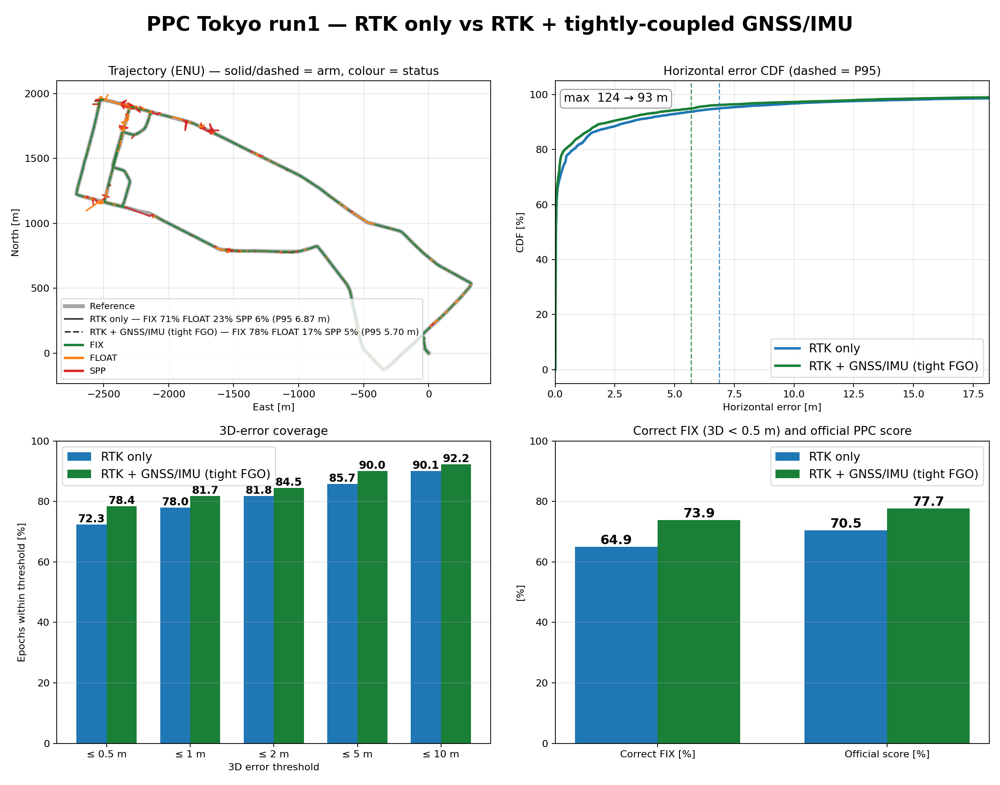
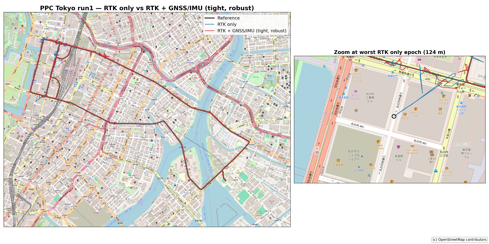
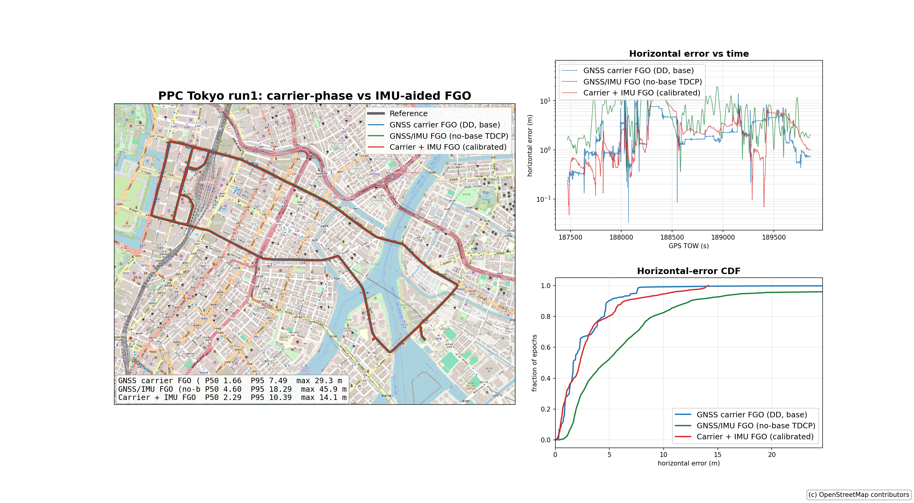
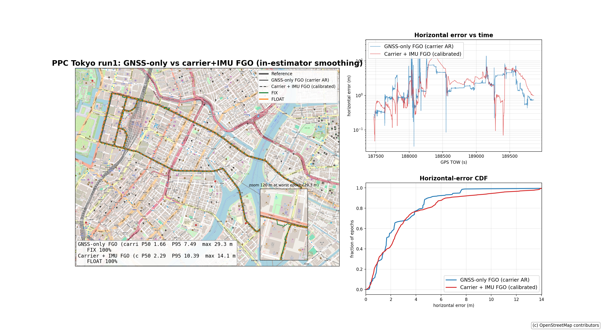
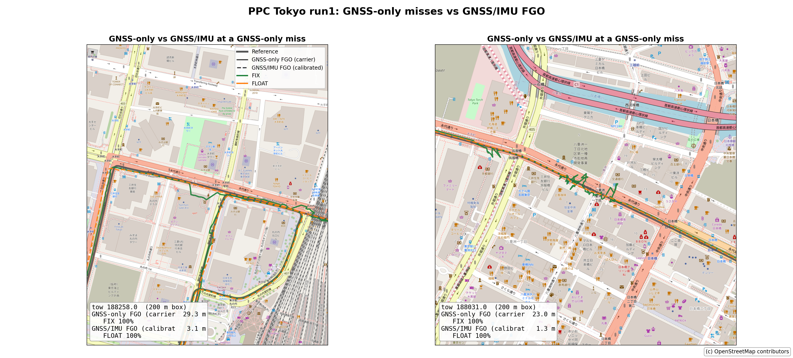

# PPC: RTK only vs RTK + tightly-coupled GNSS/IMU



The trajectory is coloured by per-epoch status (green = FIX, orange =
FLOAT, red = SPP) with solid = RTK only and dashed = fused, and the legend
prints each arm's FIX/FLOAT/SPP composition (RTK only FIX 71% / FLOAT 23% /
SPP 6%; fused FIX 78% / FLOAT 17% / SPP 5%).

OpenStreetMap overlay: left is the full route, right zooms on the worst
RTK-only epoch (near Tokyo Station), where RTK-only cuts across the building
block while the fused track follows the road.



Comparison on the public **PPC 2024 Tokyo run1** dataset (11,845 matched
epochs). The two arms use the same command base; the fused arm adds the
validated `--navi776-tc` tight-coupling preset and the in-KF heavy-tail
(Student-t) robust front-end. Scoring uses the shared PPC helpers, so the
numbers agree with `apps/gnss.py ppc-coverage-matrix` and the README tables.
Per the published navi776 sign-off protocol the compared stream is the RTK
solution (`--rtk-pos-out`), which the tight loop refines.

FIX integrity is reported after the deployable **sigma-demote** policy from
`configs/benchmarks/ppc_sigma_demote_nis2_ratio4.toml` (demote a FIXED epoch
to FLOAT when `ratio <= 4.0` or `NIS/obs > 2.0`), applied identically to both
arms via `scripts/plot_ppc_rtk_vs_imu_fusion.py --demote-max-ratio 4
--demote-nis-per-obs 2`.

| metric | RTK only | RTK + GNSS/IMU (tight, robust) | delta |
|---|---:|---:|---:|
| Correct FIX (3D < 0.5 m) | 64.95 % | **73.88 %** | **+8.93 pp** |
| Wrong FIX / FIX | 8.66 % | **5.53 %** | −3.13 pp |
| FIX rate (post-demote) | 71.10 % | **78.20 %** | +7.10 pp |
| Official PPC score | 70.46 % | **77.71 %** | **+7.25 pp** |
| P50 horizontal | 0.031 m | **0.026 m** | −0.005 m |
| P95 horizontal | 6.869 m | **5.696 m** | −1.17 m |
| 3D < 0.5 m (all epochs) | 72.33 % | **78.40 %** | +6.07 pp |
| Worst epoch | 124 m | **93 m** | −31 m |

## Ablation

`+TC` is `--navi776-tc` alone; `+robust` adds the Student-t front-end
(`--integrity-student-t-all-measurements
--integrity-student-t-degrees-of-freedom 3
--integrity-heavy-tail-activation-sigma 2.0`). All rows are scored with the
same sigma-demote policy.

| arm | FIX % | Correct FIX % | Wrong FIX % | Official % | P95 m |
|---|---:|---:|---:|---:|---:|
| RTK only | 71.10 | 64.95 | 8.66 | 70.46 | 6.869 |
| + TC | 71.38 | 68.42 | **4.15** | 74.76 | 6.859 |
| + TC + robust | **78.20** | **73.88** | 5.53 | **77.71** | **5.696** |

Tight coupling alone cuts the wrong-fix rate; the robust front-end then
converts the recovered epochs into correct fixes, raising coverage and the
official score.

## Three-run check (Tokyo run1/2/3)

Same command base, only `--navi776-tc` + Student-t changes. In-sample; not a
held-out claim.

| run | arm | Correct FIX % | Wrong FIX % | Official % | P95 m |
|---|---|---:|---:|---:|---:|
| tokyo1 | RTK | 64.95 | 8.66 | 70.46 | 6.869 |
| tokyo1 | fusion | **73.88** | **5.53** | **77.71** | **5.696** |
| tokyo2 | RTK | 68.19 | **1.74** | 83.38 | 3.398 |
| tokyo2 | fusion | **78.96** | 2.21 | **84.10** | 3.474 |
| tokyo3 | RTK | 69.18 | 3.02 | **78.21** | 8.545 |
| tokyo3 | fusion | **75.55** | **0.99** | 76.16 | **5.950** |
| **macro** | RTK | 67.44 | 4.47 | 77.35 | 6.271 |
| **macro** | fusion | **76.13** | **2.91** | **79.32** | **5.040** |

The stack raises correct-FIX on all three runs (+8.7 pp macro) and lowers
wrong-FIX and P95, but is not uniformly better per run (tokyo3 official and
tokyo2 wrong-FIX/P95 regress slightly).

## PPC lever-arm convention

The PPC README gives the IMU axes and the antenna lever arm in FRD (x forward,
y right, z down): Tokyo `0.31, 0.0, -0.55` m and Nagoya `0.593, -0.670,
-1.216` m. `--lever-arm` takes body FLU, so y and z change sign:

| City | FLU lever arm |
| --- | --- |
| Tokyo | `0.31,0,0.55` |
| Nagoya | `0.593,0.670,1.216` |

The `imu.csv` samples themselves are already FLU (stationary Acc Z ≈ +9.81).
Before 2026-10-30 two inputs disagreed with this:

- **Nagoya.** `gnss ppc-native-replay` and the online PVA tools passed the
  Nagoya FRD vector as FLU, putting the antenna 1.34 m to the wrong side and
  2.4 m too low.
- **Tokyo.** The commands on this page pass `0.31,0,-0.55` (antenna below the
  IMU). The replay benchmark already used `0.31,0,0.55`.

Six runs with the replay benchmark's command (`--preset low-cost --ratio 2.4
--max-subset-ar-drop-steps 18 --rtk-snr-weighting --no-arfilter`, plus
`--navi776-tc` for the coupled arms) were scored on the coupled RTK stream.
FIX is status 4, and a correct FIX is within 0.5 m 3D. The table gives correct
FIX as a share of epochs, followed by wrong FIX as a share of FIX:

| Run | RTK only | Previous lever arm | FLU lever arm |
| --- | --- | --- | --- |
| tokyo/run1 | 68.89% / 10.18% | 71.61% / 8.17% | 72.75% / 4.75% |
| tokyo/run2 | 77.66% / 2.14% | 80.27% / 2.38% | 80.96% / 1.85% |
| tokyo/run3 | 71.99% / 3.71% | 80.54% / 4.45% | 76.88% / 5.57% |
| nagoya/run1 | 66.34% / 15.06% | 68.16% / 9.98% | 75.05% / 4.50% |
| nagoya/run2 | 45.35% / 9.93% | 47.84% / 5.10% | 50.30% / 4.69% |
| nagoya/run3 | 32.68% / 31.60% | 54.15% / 14.18% | 53.30% / 17.10% |
| **Mean** | **60.49% / 12.10%** | **67.10% / 7.38%** | **68.21% / 6.41%** |

For the replay benchmark only the Nagoya rows change, since its Tokyo lever arm
was already FLU.

The INS-to-GNSS consistency points the same way without the reference. The
mean squared INS position correction (`imu_time_offset_score`) drops on all
three Nagoya runs with the FLU vector:

| Run | Previous | FLU |
| --- | ---: | ---: |
| nagoya/run1 | 1.149 m² | 0.902 m² |
| nagoya/run2 | 3.121 m² | 3.071 m² |
| nagoya/run3 | 3.461 m² | 3.343 m² |

The Tokyo values swing with a few large corrections and do not separate the
two signs.

### Run-to-run spread

A single run is not enough to compare two lever arms. Moving the lever arm by
2–4 cm, far below its uncertainty, moves the correct FIX of a Tokyo run by up
to 5 pp. Each sign was therefore run nine times: the value above and eight
perturbations (z ±0.02 and ±0.04 m, y ±0.02 m, x ±0.02 m). Each cell is the
mean ± sample SD over the nine runs, correct FIX first and wrong FIX second.
The last row is the six-run mean ± its standard error.

| Run | Previous lever arm | FLU lever arm |
| --- | --- | --- |
| tokyo/run1 | 72.88 ± 2.17% / 7.45 ± 2.78% | 72.18 ± 2.52% / 7.39 ± 2.97% |
| tokyo/run2 | 80.42 ± 1.83% / 3.05 ± 1.58% | 81.39 ± 1.24% / 2.89 ± 1.14% |
| tokyo/run3 | 78.09 ± 1.72% / 4.74 ± 0.52% | 76.99 ± 1.60% / 5.11 ± 2.04% |
| nagoya/run1 | 69.24 ± 3.28% / 8.57 ± 2.98% | 75.05 ± 0.00% / 4.50 ± 0.00% |
| nagoya/run2 | 47.62 ± 0.45% / 5.30 ± 0.38% | 50.30 ± 0.00% / 4.69 ± 0.00% |
| nagoya/run3 | 53.68 ± 0.56% / 15.13 ± 1.03% | 52.62 ± 1.08% / 17.91 ± 1.34% |
| **Mean** | **66.99 ± 0.26% / 7.37 ± 0.25%** | **68.09 ± 0.19% / 7.08 ± 0.22%** |

What the spread shows:

- **The FLU vector raises the six-run correct FIX by 1.10 ± 0.32 pp.** The
  wrong-FIX rate does not change significantly (−0.29 ± 0.33 pp); the
  single-run table above overstates that drop.
- **nagoya/run1 and nagoya/run2 gain for real.** With FLU their scores barely
  move under the perturbations (by at most 0.01 pp). With the previous vector, nagoya/run1 ranges
  from 65.01% to 75.02%.
- **The Tokyo differences are within the spread.** The single-run tokyo/run3
  loss of 3.7 pp is −1.10 ± 0.79 pp over nine runs.
- **nagoya/run3 loses for real: wrong FIX rise from 15.13% to 17.91%.**
  - Almost all of it is in one window, TOW 554714–554788.
  - In that window every arm holds a wrong fix, RTK only included: 14.5 m
    without the IMU, 0.8 m with the previous vector, 2.4 m with FLU.
  - With FLU the hold starts 14 s earlier, from a first fix at ratio 3.8 with
    7 ambiguities.
  - This is the RTK filter's wrong-hold problem, not a lever-arm effect.

Other RTK+IMU comparisons on these runs need the same treatment: on a single
Tokyo run, a difference below about 2 pp is noise.
`scripts/analysis/ppc_fuse_spread.py` runs the nine members per run and prints
this table. Add `--pre-fix-lever-arms` for the previous-lever-arm column:

```sh
python3 scripts/analysis/ppc_fuse_spread.py \
  --dataset-root data/PPC-Dataset --out-dir output/ppc_fuse_spread/flu
```

The urban use-case guide, its field checklist, the `gnss fuse` page, the
example configuration and the `urban-continuity-bundle` default now pass the
Tokyo FLU vector too. On Tokyo run1 the R1 recipe passes its gates with either
sign. Over the full run the FLU vector lowers the max bridge error by 0.86 m and
the fixed-P95 regression by 0.09 m; over the first 3,500 epochs it raises the
max bridge error by 0.79 m
([R1 table](use_cases/urban_rtk_fgo.md#r1-tokyo-run1-frozen-candidate)). The
commands on this page keep `0.31,0,-0.55` because they reproduce the recorded
tables.

## Wrong-fix guards under `--navi776-tc`

`gnss solve` has wrong-fix guards that `gnss fuse` did not expose. Two of them
are now passed through, both off by default:

- `--hold-kalman-update` applies the held integers as a Kalman
  pseudo-observation (RTKLIB holdamb) instead of overwriting the ambiguities
  ([hold-ambiguity note](rtk_hold_ambiguity_update.md)).
- `--min-fix-satellites <k>` refuses an ambiguity-resolution FIX with fewer
  than k non-reference satellites. k = 4 was chosen and validated on other data
  for `gnss solve` ([RTK fixes from few satellites](interfaces.md#rtk-fixes-from-few-satellites)).

Six runs with the FLU lever arm and the replay benchmark's `--navi776-tc`
command, nine runs each as in [Run-to-run spread](#run-to-run-spread). Each
cell is correct FIX (% of epochs) / wrong FIX (% of FIX), mean ± SD. The mean
row is the six-run mean ± its standard error. The last row is the mean count
of FIX above 3 m horizontal per run.

| Run | `--navi776-tc` | `--min-fix-satellites 4` | `--hold-kalman-update` | Both |
| --- | --- | --- | --- | --- |
| tokyo/run1 | 72.18 ± 2.52 / 7.39 ± 2.97 | 64.81 ± 7.79 / 4.14 ± 4.26 | 76.17 ± 1.73 / 7.77 ± 1.30 | 67.34 ± 2.32 / 7.01 ± 3.37 |
| tokyo/run2 | 81.39 ± 1.24 / 2.89 ± 1.14 | 79.76 ± 0.65 / 1.76 ± 0.85 | 81.37 ± 2.58 / 4.06 ± 2.56 | 81.10 ± 0.74 / 1.96 ± 0.70 |
| tokyo/run3 | 76.99 ± 1.60 / 5.11 ± 2.04 | 73.91 ± 1.49 / 1.54 ± 1.07 | 80.46 ± 1.68 / 3.80 ± 0.84 | 79.17 ± 1.41 / 0.52 ± 0.21 |
| nagoya/run1 | 75.05 ± 0.00 / 4.50 ± 0.00 | 74.22 ± 0.00 / 1.40 ± 0.00 | 69.04 ± 0.01 / 4.33 ± 0.01 | 67.35 ± 0.01 / 0.39 ± 0.01 |
| nagoya/run2 | 50.30 ± 0.00 / 4.69 ± 0.00 | 49.27 ± 0.00 / 4.31 ± 0.00 | 43.58 ± 0.00 / 24.75 ± 0.00 | 53.22 ± 0.00 / 4.87 ± 0.00 |
| nagoya/run3 | 52.62 ± 1.08 / 17.91 ± 1.34 | 45.06 ± 0.17 / 11.36 ± 0.04 | 63.42 ± 0.05 / 3.77 ± 0.08 | 50.65 ± 0.00 / 0.72 ± 0.00 |
| **Mean** | **68.09 ± 0.19 / 7.08 ± 0.22** | **64.50 ± 0.44 / 4.09 ± 0.25** | **69.01 ± 0.20 / 8.08 ± 0.17** | **66.47 ± 0.16 / 2.58 ± 0.19** |
| FIX > 3 m per run | 54 | 11 | 74 | 29 |

What the table shows:

- **Both together cut the wrong-FIX rate by 4.5 pp for 1.6 pp of correct
  FIX.**
  - Four runs drop to 2% or less: tokyo/run2 1.96%, tokyo/run3 0.52%,
    nagoya/run1 0.39% and nagoya/run3 0.72%.
  - tokyo/run1 keeps about 7% (see
    [the validated-only KF hold](#kf-hold-only-after-validated-fixes)).
  - Correct FIX falls most on nagoya/run1 (−7.7 pp) and tokyo/run1 (−4.8 pp).
- **The KF hold alone is not usable.** It removes the nagoya/run3 wrong hold,
  but creates a 194 s wrong hold on nagoya/run2 (wrong FIX 4.69% → 24.75%).
  With the held integers applied as measurements, the float follows the wrong
  hold, and subset fixes with only four ambiguities then pass at ratios of 800
  to 3,000.
- **k = 4 removes those thin fixes.** Alone it also cuts the wrong-FIX rate,
  but loses 3.6 pp of correct FIX.
- **The KF hold was selected on these runs.**
  - It was picked from eight existing guards, screened on one nagoya/run3 run:
    hold-fix NIS 10, NIS 10 with phase fit 0.5, a 1 m hold divergence limit,
    an unchanged hold set, 8 hold pairs, 5 fix satellites, the KF hold and the
    satellite-count ratio.
  - The same six runs then measured it, so the result is in-sample.
  - k = 4 was not chosen here. The default is unchanged.

To reproduce a column, pass its flags to the spread script after `--`:

```sh
python3 scripts/analysis/ppc_fuse_spread.py \
  --dataset-root data/PPC-Dataset --out-dir output/ppc_fuse_spread/both \
  -- --hold-kalman-update --min-fix-satellites 4
```

### KF hold only after validated fixes

With both guards, 70% of the tokyo/run1 wrong FIX lie in one window, TOW
188699–188827. There six of the nine runs hold a fix whose horizontal error is
0.22 m and whose height is 0.99 m off. Without the KF hold, eight of the nine
runs fix correctly in that window.

- At TOW 188699.4 the satellites drop from 13 to 10. Both traced runs, with
  and without the KF hold, briefly fix about 0.9 m low.
- Without the KF hold, an AR fix with 12 ambiguities is correct again 1.2 s
  later.
- With it, hold-fix fallback fixes (5 to 14 ambiguities, ratio at the
  threshold) apply the wrong integers as measurements, the float follows them,
  and later AR fixes with 8 ambiguities at ratio 4 confirm the wrong height.
- This is the same mechanism as the nagoya/run2 hold above, with too many
  satellites for k = 4 to stop it.

`--hold-kalman-update-validated-only` (with `--hold-kalman-update`) applies the
KF hold only after a validated ambiguity-resolution FIX, as RTKLIB holdamb
does, and not after the hold-fix fallback. Same runs:

| Run | KF hold, validated only | Both, KF hold validated only |
| --- | --- | --- |
| tokyo/run1 | 76.14 ± 2.13 / 8.03 ± 1.90 | 72.19 ± 1.80 / 1.62 ± 0.80 |
| tokyo/run2 | 81.18 ± 2.13 / 3.90 ± 2.39 | 81.58 ± 0.80 / 1.63 ± 0.61 |
| tokyo/run3 | 80.78 ± 1.31 / 3.81 ± 0.89 | 78.48 ± 0.90 / 0.70 ± 0.27 |
| nagoya/run1 | 69.11 ± 0.01 / 6.23 ± 0.01 | 67.64 ± 0.01 / 2.52 ± 0.01 |
| nagoya/run2 | 52.85 ± 0.01 / 8.35 ± 0.01 | 52.52 ± 0.59 / 4.81 ± 0.09 |
| nagoya/run3 | 63.36 ± 0.05 / 3.77 ± 0.08 | 50.65 ± 0.00 / 0.72 ± 0.00 |
| **Mean** | **70.57 ± 0.18 / 5.68 ± 0.18** | **67.18 ± 0.13 / 2.00 ± 0.06** |
| FIX > 3 m per run | 71 | 27 |

- **With k = 4 the wrong-FIX rate falls from 7.08% to 2.00%, for 0.91 pp of
  correct FIX.**
  - The wrong-FIX rate falls on five runs. On nagoya/run2 it rises slightly,
    from 4.69% to 4.81%.
  - tokyo/run1 drops from 7.39% to 1.62% with the same correct FIX.
  - nagoya/run1 loses 7.4 pp of correct FIX, the main cost at this threshold
    ([at a stricter threshold](#at-a-stricter-threshold) it gains instead).
- **Without k = 4 the six-run means improve on both counts** (70.57% / 5.68%
  against 68.09% / 7.08%). However, the nagoya/run1 correct FIX falls by
  5.9 pp, and the nagoya/run2 wrong-FIX rate rises from 4.69% to 8.35%.
- **Selection.**
  - The restriction follows RTKLIB and has no threshold.
  - It was written after seeing the tokyo/run1 failure, and the same six runs
    measure it, so it is in-sample like the KF hold.
  - The default is unchanged.

```sh
python3 scripts/analysis/ppc_fuse_spread.py \
  --dataset-root data/PPC-Dataset --out-dir output/ppc_fuse_spread/validated \
  -- --hold-kalman-update --hold-kalman-update-validated-only --min-fix-satellites 4
```

#### At a stricter threshold

The 0.5 m threshold counts biased holds as correct.

- On nagoya/run1, 663 of the 5,884 FIX epochs of `--navi776-tc` lie 0.25 to
  0.5 m off.
- Most of the gap is one window after TOW 551154:
  - `--navi776-tc` holds a fix about 0.34 m off for 100 s.
  - With the KF hold, the float instead follows a run of wrong AR fixes at a
    satellite drop (0.25 to 0.98 m off, ratio 9 to 412). It stays about 0.9 m
    off and FLOAT for 115 s.

Counting a FIX as correct below 0.10 m or 0.25 m instead, six-run mean ± SE
(% of epochs):

| Arm | 3D < 0.10 m | 3D < 0.25 m | 3D < 0.50 m |
| --- | ---: | ---: | ---: |
| `--navi776-tc` | 41.49 ± 0.27 | 62.93 ± 0.28 | 68.09 ± 0.19 |
| KF hold, validated only, k = 4 | 44.22 ± 0.12 | 65.90 ± 0.14 | 67.18 ± 0.13 |
| KF hold, validated only | 44.58 ± 0.11 | 68.35 ± 0.17 | 70.57 ± 0.18 |

Per run at 3D < 0.25 m, mean ± SD:

| Run | `--navi776-tc` | KF hold, validated only, k = 4 | KF hold, validated only |
| --- | --- | --- | --- |
| tokyo/run1 | 66.94 ± 4.18 | 69.91 ± 1.98 | 72.46 ± 1.82 |
| tokyo/run2 | 78.77 ± 1.47 | 80.84 ± 0.83 | 79.99 ± 2.12 |
| tokyo/run3 | 73.25 ± 2.02 | 77.75 ± 1.02 | 78.92 ± 1.11 |
| nagoya/run1 | 66.19 ± 0.00 | 66.97 ± 0.01 | 67.52 ± 0.01 |
| nagoya/run2 | 42.49 ± 0.00 | 50.38 ± 0.60 | 50.53 ± 0.01 |
| nagoya/run3 | 49.91 ± 0.96 | 49.58 ± 0.00 | 60.70 ± 0.07 |

- **With k = 4, the validated-only KF hold matches or beats `--navi776-tc` on
  every run at 0.25 m.** nagoya/run3 is level (49.58% against 49.91%).
  nagoya/run1 goes from 66.19% to 66.97%. Its 7.4 pp loss at 0.5 m is the
  biased holds.
- **Without k = 4 it is ahead on every run at 0.25 m.** Its wrong-FIX rate at
  0.5 m is still higher on nagoya/run1 and nagoya/run2.

`--correct-3d-m 0.25` (or `0.1`) makes the spread script score at that
threshold.

### UrbanNav out-of-sample check

The guards were chosen and measured on the six PPC runs. UrbanNav Tokyo
(2018-12-19, Trimble rover) is the check outside them.

- **Data.** Odaiba and Shinjuku.
  - The raw rover, base, navigation and reference files match the SHA256 that
    `docs/urbannav_hero_clip_fix_evaluation.json` records.
  - They were converted with `scripts/convert_urbannav_to_ppc_layout.py`.
  - The lever arm is zero, as in
    [the UrbanNav holdout contract](online_pva_default_switch_holdout_v1.md).
  - The base is `--base-ecef -3961904.9530 3348993.7578 3698211.7553`, as in
    `scripts/analysis/evaluate_urbannav_fix_continuity.py`.
- **Not untouched.** These drives were used before for the `gnss solve`
  KF-hold evaluation ([NO_GO](rtk_hold_ambiguity_update.md)). The guards had
  not been run on them under `gnss fuse --navi776-tc`.
- **Rule, written before the run.**
  - A is `--navi776-tc`. B is A plus `--hold-kalman-update
    --hold-kalman-update-validated-only --min-fix-satellites 4`.
  - B passes if, on both drives, (1) its mean wrong-FIX rate at 0.5 m is below
    A's, and (2) its mean FIX within 0.25 m is not more than 1 pp below A's.
- **A discarded first run.** It used the RINEX header base position, which is
  0.72 m east of the base coordinate above, and put almost every FIX 0.7 m off.
  It was rerun with `--base-ecef`. The rule was not changed.

Nine runs each. FIX within 0.5 m, 0.25 m and 0.10 m are % of epochs, and wrong
FIX is % of FIX at 0.5 m (mean ± SD). FIX above 3 m is the mean count per run.

| Drive | Arm | FIX within 0.5 m | Wrong FIX | FIX within 0.25 m | FIX within 0.10 m | FIX > 3 m |
| --- | --- | ---: | ---: | ---: | ---: | ---: |
| Odaiba | A | 64.67 ± 0.03 | 3.60 ± 0.11 | 62.46 ± 0.02 | 52.67 ± 0.04 | 11 |
| Odaiba | B | 63.21 ± 0.01 | 2.03 ± 0.08 | 61.48 ± 0.01 | 52.54 ± 0.01 | 65 |
| Shinjuku | A | 64.87 ± 0.36 | 17.63 ± 0.14 | 53.93 ± 0.34 | 43.38 ± 0.34 | 60 |
| Shinjuku | B | 68.66 ± 0.04 | 5.49 ± 0.00 | 58.38 ± 0.02 | 45.08 ± 0.03 | 44 |

- **B passes the rule on both drives.**
  - The wrong-FIX rate falls from 3.60% to 2.03% on Odaiba and from 17.63% to
    5.49% on Shinjuku.
  - FIX within 0.25 m change by −0.98 pp on Odaiba, just inside the 1 pp limit,
    and by +4.45 pp on Shinjuku.
- **B holds a large wrong fix on Odaiba.**
  - FIX above 3 m rise from 11 to 65. All nine runs fix at TOW
    273759–273773, for 13 s, about 12 m off horizontally and 44 m off in
    height.
  - Just before, the satellites drop to 7–9 and the floats of both arms drift
    20–47 m off, mostly in height.
  - A has 8 wrong FIX epochs around the window, 6–10.5 m off horizontally.
    Seven of them fall at TOW 273752.6–273757.4. Inside the window A is FLOAT
    except for one epoch.
  - B fixes on its already wrong float with 6 ambiguities at ratio 3.9. The KF
    hold keeps that fix, and later AR fixes confirm it at ratios up to 141.
  - This is the float wrong-basin failure of the
    [Nagoya 3 root cause](ppc_nagoya3_wrong_fix_root_cause.md): AR certifies
    a float that is already wrong.
    - The KF hold does not create the basin, but it makes a fix inside it
      likelier and keeps it.
    - A lower wrong-FIX rate does not exclude such fixes.
- **The guards stay opt-in.**

```sh
python3 scripts/convert_urbannav_to_ppc_layout.py --raw-dir <raw> --run Odaiba \
  --output-root data/urbannav_ppc
python3 scripts/analysis/ppc_fuse_spread.py --dataset-root data/urbannav_ppc \
  --runs urbannav/Odaiba_trimble urbannav/Shinjuku_trimble --lever-arm 0,0,0 \
  --out-dir output/ppc_fuse_spread/urbannav_b \
  -- --base-ecef -3961904.9530 3348993.7578 3698211.7553 \
  --hold-kalman-update --hold-kalman-update-validated-only --min-fix-satellites 4
```

### Why tokyo/run3 loses to M4

On tokyo/run3, `--navi776-tc` has 3.1 pp less correct FIX than M4
([nine-run re-check](navi776_techniques.md#nine-run-re-check-2026-10-30)).
The nine runs of both arms were compared epoch by epoch.

- **Two windows.** Per run, `--navi776-tc` loses 1,224 correct-FIX epochs (814
  to FLOAT, 410 to wrong FIX) and gains 745, a net loss of 479 of 15,239.
  - TOW 180660–180840 loses 324 net, and TOW 181680–181920 loses 267.
  - The rest of the run gains 112.
- **The first window depends on the lever arm.**
  - The car stands still there for about 100 s.
  - All nine M4 runs give the same result: 739 correct-FIX epochs.
  - The nine `--navi776-tc` runs give 82 to 731.
- **The mechanism**, traced on the run whose lever arm has y moved by −2 cm
  (`0.310,-0.020,0.550`, 82 correct-FIX epochs in the window):
  1. While the car stands, the float drifts. The subset AR fixes on it, at
     ratio 13–28, move from 0.06 m to 0.22 m off horizontally in 1.6 s (TOW
     180665.0–180666.6), and the full-set ratio falls from 6.8 to 1.8.
  2. At TOW 180666.8 LAMBDA fails (ratio 1.5). The hold-fix fallback rounds the
     6 of its 10 pairs that have no held integer, and the fix jumps 0.34 m.
  3. At TOW 180669.2 it rounds 7 of 11 and jumps 0.76 m, to 0.91 m off.
  4. It stays fixed for the rest of the stop, 0.79–0.99 m off (10th–90th
     percentile, 96 s). 78% of these epochs have ratio 6.5 or less.
  - Over the stop (TOW 180665–180765) this run has 16 correct and 485 wrong
    FIX epochs. The same lever arm with only the Doppler rows has 498 correct
    and none wrong, and with only the adaptive noise 501 and none.
- **The second window ends the same way.** With the unperturbed lever arm, at
  TOW 181887.0:
  - LAMBDA fails (ratio 1.02).
  - The fallback rounds 12 of 30 pairs, jumps 0.86 m and holds for 25 s.
  - M4 keeps an AR fix there at ratio 29.
- **Few holds turn a correct FIX wrong, but one can last a whole stop.** With
  the unperturbed lever arm on the six runs, 35 of 3,396 hold-fix epochs turn
  a correct FIX wrong, 13 of them with rounded pairs.

Three hold guards were measured, nine runs each. Correct FIX is % of epochs
(mean ± SD per run, ± SE for the six-run mean), and wrong FIX is % of FIX at
0.5 m (six-run mean ± SE).

| Arm | tokyo/run3, 0.5 m | tokyo/run3, 0.25 m | Six runs, 0.5 m | Six runs, 0.25 m | Wrong FIX |
| --- | ---: | ---: | ---: | ---: | ---: |
| M4 | 80.13 ± 2.04 | 76.99 ± 2.00 | 67.58 ± 0.20 | 62.99 ± 0.20 | 6.63 ± 0.14 |
| `--navi776-tc` | 76.99 ± 1.60 | 73.25 ± 2.02 | 68.09 ± 0.19 | 62.93 ± 0.28 | 7.08 ± 0.22 |
| + no hold that rounds a pair | 74.85 ± 1.84 | 73.82 ± 1.97 | 63.53 ± 0.18 | 61.79 ± 0.19 | 4.83 ± 0.03 |
| + no hold that rounding moves by more than 0.1 m | 74.68 ± 3.26 | 73.49 ± 3.10 | 67.64 ± 0.20 | 64.25 ± 0.21 | 5.07 ± 0.07 |
| + KF hold, validated only | 80.78 ± 1.31 | 78.92 ± 1.11 | 70.57 ± 0.18 | 68.35 ± 0.17 | 5.68 ± 0.18 |

- **"No hold that rounds a pair"** is `RTKConfig::hold_fix_unchanged_set_only`
  (`gnss solve --hold-fix-unchanged-set`). `gnss fuse` has no flag for it, and
  it was measured with an experiment build.
- **"More than 0.1 m"** exists only in an experiment build.
  - It compares the hold on all pairs with the hold on the matched pairs alone.
  - Correct rounded holds move by a median of 0.009 m (90th percentile
    0.063 m). The 13 that turn a correct FIX wrong move by a median of 0.16 m.
  - The 0.1 m was chosen on these runs.
  - A χ² test of the same move against its own covariance needs no threshold.
    However, the KF covariance is about ten times too small for it, and it
    rejects 63% of the correct rounded holds.
- **Neither of these two guards recovers tokyo/run3.** Both lose more correct
  FIX there. The rounded hold is only the last step; the cause is the float
  drift before it. Neither guard is adopted.
- **The validated-only KF hold does recover it**: 80.78% against M4's 80.13%
  (78.92% against 76.99% at 0.25 m).
  - The KF hold keeps the float on the integers of the last validated fix, so
    it does not drift while the car stands.
  - In the first window, seven of its nine runs have at most 11 wrong-FIX
    epochs; the `--navi776-tc` runs have 42 to 586. Its correct FIX there
    (403–656) stays below M4's 739.
  - Its costs are those [above](#kf-hold-only-after-validated-fixes): it is
    in-sample, the nagoya/run2 wrong-FIX rate is 8.35%, and on UrbanNav it
    was measured only with `--min-fix-satellites 4`.

### Independent checks of a re-acquired fix (not adopted)

The [Nagoya 3 root cause](ppc_nagoya3_wrong_fix_root_cause.md) asks for a
permit: a fix may be re-acquired only when an estimator that does not share
the KF state agrees. Three candidates were measured under `--navi776-tc`,
with the unperturbed lever arm on the six runs.

- **Where the wrong FIX start.**
  - 1,401 of the 2,319 wrong-FIX epochs (60%) lie in FIX segments whose first
    epoch is already wrong. So do 207 of the 306 FIX more than 3 m off
    horizontally (68%).
  - 1,099 of those 1,401 epochs follow a FLOAT gap of 5 s or less.
  - A check at re-acquisition is therefore the right place.
- **Same-epoch SPP does not separate them.**
  - In wrong-FIX epochs the SPP is itself off: median 14.2 m for wrong FIX
    0.5–3 m off and 10.6 m for those 3 m or more off (3D), against 2.9 m for
    correct FIX. It shares the corrupted code measurements.
  - The best per-epoch gate (FIX–SPP distance in their combined covariance,
    χ² above 50) removes 47 of the 470 FIX 3 m or more off, and 32 correct FIX.
- **`--library-fix-integrity-gate` is fail-closed on every epoch.**
  - On tokyo/run2 it cuts the wrong-FIX rate from 1.85% to 0.04% and FIX above
    3 m from 36 to 0.
  - However, correct FIX fall from 80.96% to 57.37%.
  - It also changes the RTK configuration, so it cannot serve as a
    re-acquisition-only check.
- **An INS bridged from the last FIX does not separate them.**
  - The bridge copies the loose ESKF's velocity, attitude and biases at each
    FIX, anchors on that FIX, and then propagates with the IMU only.
  - Under `--navi776-tc` the loose ESKF diverges: its velocity input, the RTK
    velocity state, is metres per second off
    ([known issue](navi776_techniques.md#known-issue-the-velocity-state-2026-10-31)).
    The bridge was therefore measured with experiment build B of that note,
    in which the loose ESKF takes the SPP Doppler velocity.
  - Its error against the truth is 0.13 m (median) less than 1 s after the
    FIX, but 2.66 m after 1–5 s and 15.7 m after 5–30 s. That is about 13 times
    its own σ.
  - 156 of the 208 segments that start wrong follow a wrong FIX, which the
    bridge inherits.
  - Where the last FIX is correct and the gap is 5 s or less, rejecting a
    re-acquired fix more than 0.5 m from the bridge removes 32 of 40 wrong
    starts and 86 of 268 correct ones.

As with [CLAS and the PPC IMU](ppc_clas_imu_experiments.md), the INS has no
absolute position except the fixes it is meant to check. None of the three is
adopted.

### Candidates on UrbanNav Hong Kong and Tokyo

On the six PPC runs a few events decide most comparisons. The candidates of
the last sections were therefore also run on UrbanNav, nine runs each.

- **Data.**
  - UrbanNav Tokyo Odaiba and Shinjuku: Trimble rover, as in
    [the out-of-sample check](#urbannav-out-of-sample-check).
  - UrbanNav Hong Kong Deep-Urban-1 and Harsh-Urban-1: NovAtel Flexpak6 rover
    at 1 Hz, HKSC base 2.7–5.6 km away, Xsens IMU.
    - Converted with `scripts/convert_urbannav_hk_to_ppc_layout.py`. Every
      output matches the SHA256 recorded in
      [holdout contract v3](online_pva_default_switch_holdout_v3.md).
    - That contract scored them, so they are development data. `gnss fuse`
      had not been run on them before.
    - The baselines are longer than 1 km, so the Doppler rows and the
      adaptive noise are off there. The lever arm is zero, as in the
      contract.
- **The Hong Kong truth is about 0.6 m from the antenna.**
  - The FIX of `--navi776-tc` on Deep are offset from the truth by a constant
    vector in the body frame: 0.56 m backwards, 0.01 m left and 0.23 m down
    (median of the 230 FIX within 1.5 m of the truth). Without a correction
    almost every correct FIX would score as wrong.
  - The documented extrinsics do not reproduce it. `extrinsic.yaml` of the
    UrbanNav repository gives a translation of (0, 0.86, −0.31) m (x right,
    y forward, z up) for `ANTENNA_T_IMU` and 0.14 m up for `body_T_SPAN`.
  - The measured offset is therefore added to the truth for every arm and
    both Hong Kong runs. It was estimated with the truth, from the control
    arm.
- **Harsh-Urban-1 cannot separate the arms.** Every arm fixes 3.8–4.9% of
  the epochs, and 98% of those fixes are wrong.

Correct FIX (% of epochs) / wrong FIX (% of FIX) at 0.5 m, mean of nine
runs. The PPC column is the six-run mean.

| Arm | PPC | Odaiba | Shinjuku | HK Deep |
| --- | ---: | ---: | ---: | ---: |
| `--navi776-tc` | 68.09 / 7.08 | 64.67 / 3.60 | 64.87 / 17.63 | 17.07 / 32.2 |
| + validated-only KF hold | **70.57 / 5.68** | 64.05 / 4.77 | **72.68 / 8.26** | 16.40 / 31.3 |
| + RTK ZUPT (experiment) | 67.44 / 7.88 | 64.77 / 3.37 | 64.93 / 17.67 | 14.03 / 40.4 |
| + RTK ZUPT and validated-only KF hold (experiment) | 69.29 / 7.76 | 64.11 / 4.57 | 72.68 / 8.28 | 15.00 / 37.5 |
| B: corrected velocity loop (experiment) | 65.42 / 10.38 | 64.80 / 3.32 | 63.50 / 18.33 | **19.93 / 27.9** |
| No high-residual FLOAT reset (experiment) | 55.57 / 11.07 | 63.38 / 5.34 | 64.59 / 18.21 | 13.93 / 40.2 |

- **The validated-only KF hold is the only candidate that holds up.**
  - It gains 2.5 pp on PPC and 7.8 pp on Shinjuku, where the wrong-FIX rate
    halves.
  - It loses 0.6 pp on Odaiba, where the wrong-FIX rate rises by 1.2 pp, and
    0.7 pp on HK Deep.
  - At 0.25 m it goes from 62.93% to 68.35% on PPC and from 53.93% to 59.87%
    on Shinjuku. It is 0.1 pp better on Odaiba and 1.3 pp worse on HK Deep.
  - Every dataset here is development data for it.
  - A [frozen holdout](navi776_kf_hold_holdout.md) on HK Medium-Urban-1 was
    [inconclusive](navi776_kf_hold_holdout_results.md): the control fixes
    only 1.49% of the epochs there. The preset is unchanged.
- **The RTK ZUPT** ([velocity-state note](navi776_techniques.md#known-issue-the-velocity-state-2026-10-31))
  changes UrbanNav by 0.1 pp or less and loses 3 pp on HK Deep.
- **The corrected velocity loop B** is the best arm on HK Deep (+2.9 pp, wrong
  FIX −4.3 pp). However, it loses on PPC and on Shinjuku.
- **The high-residual FLOAT reset is worth keeping.**
  - The `low-cost` preset resets every ambiguity after five FLOAT epochs whose
    prefit residuals exceed 4 m RMS or 10 m. The prefit residuals include the
    rows that the update then rejects (3 m outlier threshold).
  - On the six runs it fires 636 times. The median prefit RMS there is
    11.3 m, against 0.52 m for the rows the update keeps.
  - After a reset every lock count starts again, and AR waits five epochs.
    On nagoya/run1 at TOW 550943.8 that cost the stop described in the
    velocity-state note.
  - Even so, without it the PPC runs fall to 55.57% correct FIX, and Odaiba,
    Shinjuku and HK Deep lose too.

## In-KF component: heavy-tail front-end

## In-KF component: heavy-tail front-end

`--integrity-student-t-*` (IRLS Student-t / Huber / Laplacian) weights the RTK
measurement rows. It was previously assigned only inside the
`--library-fix-integrity-gate` block, so it was a silent no-op on this lane
(byte-identical output); it now applies to the primary RTK config whenever
selected. Default behaviour is unchanged.

## Rejected: turn-aware SPP stabilizer

`--rtk-single-stabilizer` extends the fixed-anchor stabilizer to SPP fallback
output and reduces the Tokyo run1 worst epoch (93 → 65 m), but it is **not
promoted**: on Tokyo run2 it replaced a moderate SPP error with a bad
quadratic extrapolation and raised the worst epoch from 63 m to 210 m. It
stays default-off and opt-in for research.

## Rejected: FDE with exclusion on the global NIS gate

A row-exclusion FDE (when the global normalized-innovation gate would reject
the update, exclude the worst-normalized-innovation row and retry up to N
times) was implemented on top of the robust stack and reverted after it
degraded every run:

| run | arm | Official % | P95 m | Worst epoch m |
|---|---|---:|---:|---:|
| tokyo1 | robust | 77.71 | 5.70 | 93 |
| tokyo1 | + FDE | 64.08 | 14.03 | 93 |
| tokyo2 | robust | 84.10 | 3.47 | 63 |
| tokyo2 | + FDE | 63.02 | 4.06 | **146** |
| tokyo3 | robust | 76.16 | 5.95 | 251 |

The PPC RTK update routinely exceeds NIS/obs ≈ 3 without a fault, so the gate
fires on healthy epochs; excluding rows then destroys redundancy and degrades
the solution more than the fault it removes. A viable FDE needs a calibrated
fault-free innovation distribution (or a subset-consensus test) rather than a
fixed global threshold.

## Carrier-phase FGO vs IMU-aided FGO

`gnss_fgo` now accepts `--imu <imu.csv>` and builds a tightly-coupled
double-difference-carrier + IMU factor graph (GTSAM Pose3 fixed-lag). The
flag is opt-in: without `--imu` the output is byte-identical to before.
Related knobs: `--imu-lever-arm X Y Z`, `--imu-no-mounting`,
`--imu-fixed-lag <s>` (default 20, 0 = batch), `--imu-noise-scale <s>`
(multiplier, default 1), `--imu-no-noise-calibrate`.



Trajectory colour is the per-epoch status (green = FIX, orange = FLOAT,
grey = no status field in the submission CSV) and the line style is the
arm. The stats box prints each arm's composition: the DD-carrier arm is
FIX 100%, the calibrated carrier+IMU arm is FLOAT 100%, and the no-base
TDCP submission carries no status.

Carrier-phase ambiguity resolution dominates: on Tokyo run1 the code-only
no-base FGO (P50 3.62 m) is ~2x worse than the carrier FGO (P50 1.66 m),
and the no-base IMU TDCP FGO is 4.60 m. The pure GNSS carrier arm runs the
Eigen batch solver while the IMU arm runs the GTSAM fixed-lag smoother
(batch GTSAM is ~15 min for 1000 epochs), so the two arms differ by solver.

### Six-run check (Tokyo and Nagoya, run1/2/3)

carrier-only vs carrier + IMU (calibrated), horizontal error P50/P95/max
(m) and mean horizontal acceleration (in-estimator smoothness, m/s²):

| run | carrier-only P50/P95/max | carrier+IMU P50/P95/max | acc only -> IMU |
|---|---|---|---|
| tokyo1 | 1.66 / 7.49 / 29.3 | 2.29 / 10.39 / 14.1 | 5.13 -> 0.35 |
| tokyo2 | 0.39 / 2.91 / 40.3 | 0.47 / 2.47 / 15.9 | 5.22 -> 0.37 |
| tokyo3 | 0.61 / 10.95 / 45.7 | 0.50 / 10.17 / 30.7 | 6.16 -> 0.33 |
| nagoya1 | 0.37 / 7.59 / 158.8 | 0.61 / 20.85 / 61.9 | 7.23 -> 0.27 |
| nagoya2 | 1.58 / 16.56 / 92.7 | 3.05 / 11.61 / 21.5 | 3.77 -> 0.27 |
| nagoya3 | 3.60 / 10.78 / 22.3 | 3.68 / 16.65 / 22.5 | 3.93 -> 0.33 |

The smoothing is consistent across all six runs (~15-20x lower
acceleration), and the worst epoch improves in five of six (up to
158.8 -> 61.9 m on nagoya1). The median is mixed (slightly worse in
tokyo1/2 and nagoya1/2, better in tokyo3), so this is a robustness and
smoothness trade, not a uniform accuracy win.

### IMU noise calibration

Instead of a hand-tuned noise scale, `--imu` estimates the IMU noise from
the leading low-dynamics window (first 250 samples, the same window used
for leveling): the per-axis residual std converted to a continuous-time
density with the native 10 ms sample interval. PPC Tokyo run1 yields
accel `0.0055 m/s²/√Hz` and gyro `0.00022 rad/s/√Hz`, ~18x and ~45x below
the GTSAM defaults. This is truth-free (no reference used) and reproduces
the earlier hand-tuned "noise x0.1" result to within 0.01 m.

### In-estimator trajectory smoothing

With the calibrated IMU noise, the inuex35 reference DD sigmas
(`--dd-carrier-sigma 0.003 --dd-pseudorange-sigma 0.3`) and a 20 s
fixed-lag window the estimated trajectory is smoothed entirely inside the
estimator — no post-processing (filter, RTS or spline). On Tokyo run1 the
carrier+IMU arm reaches P50 1.80 / P95 7.12 / max 8.7 m (RMS 3.50) versus
the carrier-only P50 1.67 / P95 7.50 / max 29.7 m (RMS 3.61): the median is
within 0.13 m while the tail and worst epoch improve. The figure
auto-draws a 120 m zoom inset at the worst combined epoch.

### Ambiguity resolution in the fixed lag

The fixed-lag AR resolves integers too. With `--fixed-lag-partial-ar`
(ranked subset LAMBDA retry) Tokyo run1 fixes 2610/11866 epochs and the
FIXED epochs are accurate (horizontal P50 0.299 m, RMS 2.65) versus the
float epochs (P50 2.05, RMS 3.72) — consistent with the upstream inuex35
reference FixRMS 0.29 m. The full-set LAMBDA ratio sits near 1.0 because a
near-singular joint ambiguity mode degenerates the search (the ambiguity
estimates themselves are precise: median std 0.04 cyc, LAMBDA BSR 1.0); the
subset retry drops that mode.

A fix-and-hold arm is available opt-in (`--ambiguity-hold
--allow-partial-fix-and-hold --ambiguity-hold-min-fixed 1`, meaningful only
together with `--solve-exception-recovery --ddpr-anchor`). It labels held
epochs FIXED with the smoother position (no post-processing) and improves
the median on all three Tokyo runs, at a small tail cost on run1/run3:

| run | float P50 / P95 / max | fix-and-hold P50 / P95 / max |
|---|---|---|
| tokyo1 | 1.80 / 7.12 / 8.7 | 1.62 / 7.73 / 9.2 |
| tokyo2 | 0.39 / 2.37 / 15.8 | 0.24 / 2.27 / 14.2 |
| tokyo3 | 0.50 / 10.17 / 30.7 | 0.29 / 12.03 / 33.4 |

`--solve-exception-recovery` is required for safety: without it a per-epoch
`smoother.update()` that throws `IndeterminantLinearSystemException` leaves
the ISAM2 state corrupted, so every later update throws `map::at` and tokyo
run2 diverges by 6370 km at tow 178316 (28% of epochs NONE). With recovery
the exception is handled once and the run stays healthy.

### FIX integrity and the AR ratio threshold

The FIXED label is only trustworthy with a strict ratio test. The
real-data-fixed preset used ratio 1.5, at which the fixed-lag AR accepted
~50% wrong fixes; the preset now uses **3.0** (the inuex35 default), which
makes the FIXED epochs genuine (wrong-fix = FIXED epochs with 3D error
> 0.5 m, PPC convention; `scripts/score_ppc_fix_integrity.py`):

| run | fix% | wrong-fix% | correct-fix% | fixed median 3D |
|---|---:|---:|---:|---:|
| tokyo1 | 6.4 | 7.3 | 5.9 | 0.05 m |
| tokyo2 | 18.1 | 4.1 | 17.3 | 0.03 m |
| tokyo3 | 24.8 | 2.4 | 24.2 | 0.04 m |
| tokyo1 (ratio 1.5) | 22.0 | 50.0 | 11.0 | 0.47 m |

The correct-fix rate is route-dependent (tokyo1 is the hard one); raising it
further needs the upstream AR strengths (continuity priors, SD Doppler,
fix-and-hold), not a looser ratio.

**Carrier-only Eigen caveat**: the Eigen batch path (no `--imu`) still
reports FIX 100% with ~93% wrong fixes even with LAMBDA ratio 29.7 and a
tighter carrier sigma — its integer-constrained batch solution is
meter-level, so its FIXED status is not trustworthy. Pass
`--report-batch-fix-as-float` to report FLOAT instead (opt-in; the batch
FIXED behaviour is covered by the frozen tests), or use
`--epoch-lambda-fixed-output`, whose per-epoch conditional update does yield
cm-level fixes (wrong-fix 2.8% on tokyo1). The fixed-lag path is the one
with genuine fixes at a useful rate.

Of the other upstream levers, NHC/ZUPT factors (`--nhc --zupt`),
variance-ranked partial AR, ambiguity-between factors and a 30-cycle
new-arc prior all fail to lift the fix rate and mostly degrade accuracy, so
the remaining gap to the reference 63% fix rate needs the full upstream
integrity stack, not a parameter change.



Two GNSS-only misses at 200 m OSM zoom (tow 188258: carrier-only 29.3 m
vs IMU 3.1 m; tow 188031: 23.0 m vs 1.3 m). The solid carrier-only track
leaves the road while the dashed calibrated IMU track follows it.



### Limitations

The carrier + IMU arm is limited by the GTSAM fixed-lag solver, not by the
IMU. On Tokyo run1 its worst epoch is a ~5 s sustained segment (tow
188360-188370) sitting at 14.1 m while the carrier-only arm is at 7.6 m;
the two arms also use different solvers (Eigen batch vs GTSAM fixed-lag),
so they are not a pure IMU ablation. Conversely the IMU arm caps the
carrier-only 29 m excursions.

Neither of the obvious ways to remove that 14 m segment works:

- **GTSAM batch + IMU** (fixed-lag 0) finishes with a DD carrier residual
  RMS of 13.2 m (unconverged), P95 20.5 m, max 155 m and ~111 m/s²
  position acceleration. Seeding it from the fixed-lag solution and raising
  the iteration cap to 20 give byte-identical broken output, so the batch
  path is not a usable operating point here.
- Lowering the IMU trust (noise x10/x30) raises P50/P95/max; enabling
  `--epoch-lambda-fixed-output` fixes only 853/11866 epochs and collapses
  the smoothness from 0.35 to 1.90 m/s².

Net: the calibrated IMU fixed-lag arm trades median/P95 for in-estimator
smoothness and gross-error robustness; it is not uniformly more accurate.

## Reproduce

```bash
export LD_LIBRARY_PATH=$HOME/.local/lib:${LD_LIBRARY_PATH:-}

# RTK only
build/apps/gnss_fuse \
  --data-dir data/PPC-Dataset/tokyo/run1 --lever-arm 0.31,0,-0.55 \
  --preset low-cost --ratio 2.4 --max-subset-ar-drop-steps 18 \
  --rtk-snr-weighting --no-arfilter \
  --rtk-pos-out output/ppc_rtk_vs_imu_fusion/tokyo1_canon/off_rtk.pos

# RTK + tightly-coupled GNSS/IMU + robust front-end
build/apps/gnss_fuse \
  --data-dir data/PPC-Dataset/tokyo/run1 --lever-arm 0.31,0,-0.55 \
  --preset low-cost --ratio 2.4 --max-subset-ar-drop-steps 18 \
  --rtk-snr-weighting --no-arfilter --navi776-tc \
  --integrity-student-t-all-measurements \
  --integrity-student-t-degrees-of-freedom 3 \
  --integrity-heavy-tail-activation-sigma 2.0 \
  --rtk-pos-out output/ppc_rtk_vs_imu_fusion/tokyo1_robust/student_t3.pos

# Figure
python3 scripts/plot_ppc_rtk_vs_imu_fusion.py \
  --reference data/PPC-Dataset/tokyo/run1/reference.csv \
  --rtk-pos   output/ppc_rtk_vs_imu_fusion/tokyo1_canon/off_rtk.pos \
  --fusion-pos output/ppc_rtk_vs_imu_fusion/tokyo1_robust/student_t3.pos \
  --output docs/ppc_rtk_vs_gnss_imu_fusion.png \
  --demote-max-ratio 4 --demote-nis-per-obs 2 \
  --title "PPC Tokyo run1 — RTK only vs RTK + tightly-coupled GNSS/IMU"

# Carrier-phase FGO arms (gnss_fgo)
P=data/PPC-Dataset/tokyo/run1
build/apps/gnss_fgo --obs $P/rover.obs --base $P/base.obs --nav $P/base.nav \
  --preset real-data-fixed --out output/ppc_fgo/tokyo1_carrier.pos
# --imu defaults to static-window noise calibration + 20 s fixed-lag
build/apps/gnss_fgo --obs $P/rover.obs --base $P/base.obs --nav $P/base.nav \
  --preset real-data-fixed --imu $P/imu.csv \
  --out output/ppc_fgo/tokyo1_carrier_imu.pos
build/apps/gnss_fgo_imu_no_base --obs $P/rover.obs --imu $P/imu.csv --nav $P/base.nav \
  --all-epochs --out output/ppc_fgo/tokyo1_no_base_imu.csv

# Carrier-phase vs IMU-aided FGO figure (3 arms)
python3 scripts/plot_ppc_gnss_vs_fgo.py \
  --reference $P/reference.csv \
  --gnss-pos  output/ppc_fgo/tokyo1_carrier.pos \
  --imu-csv   output/ppc_fgo/tokyo1_no_base_imu.csv \
  --extra-pos output/ppc_fgo/tokyo1_carrier_imu.pos \
  --output docs/ppc_fgo_carrier_vs_imu.png \
  --gnss-label "GNSS carrier FGO (DD, base)" \
  --imu-label "GNSS/IMU FGO (no-base TDCP)" \
  --extra-label "Carrier + IMU FGO (calibrated)" \
  --title "PPC Tokyo run1: carrier-phase vs IMU-aided FGO"

# In-estimator smoothing figure (carrier-only vs calibrated carrier+IMU)
python3 scripts/plot_ppc_gnss_vs_fgo.py \
  --reference $P/reference.csv \
  --gnss-pos  output/ppc_fgo/tokyo1_carrier.pos \
  --extra-pos output/ppc_fgo/tokyo1_carrier_imu.pos \
  --output docs/ppc_fgo_imu_smoothing.png \
  --gnss-label "GNSS-only FGO (carrier AR)" \
  --extra-label "Carrier + IMU FGO (calibrated)" \
  --title "PPC Tokyo run1: GNSS-only vs carrier+IMU FGO (in-estimator smoothing)"
```

## Scope

Development runs, in-sample, not a held-out or leaderboard claim. The
tight-coupling preset is validated for short-baseline urban runs and stays
opt-in.
