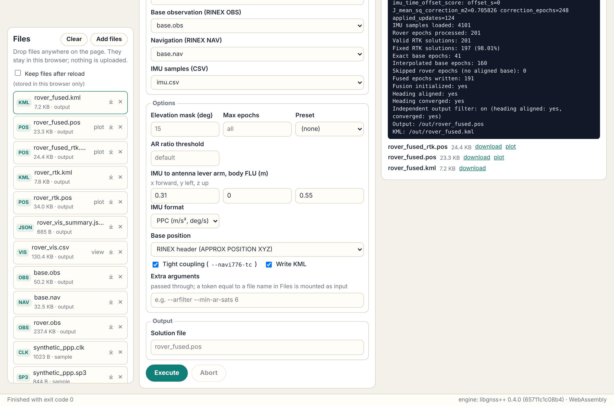
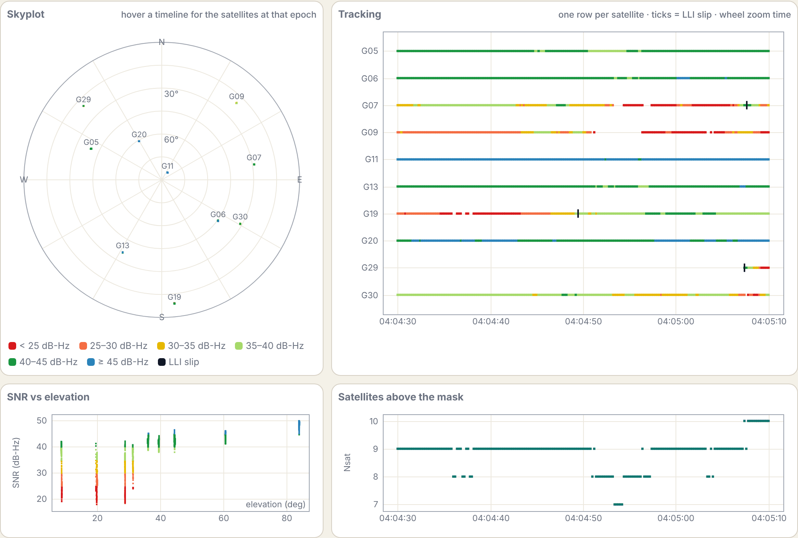
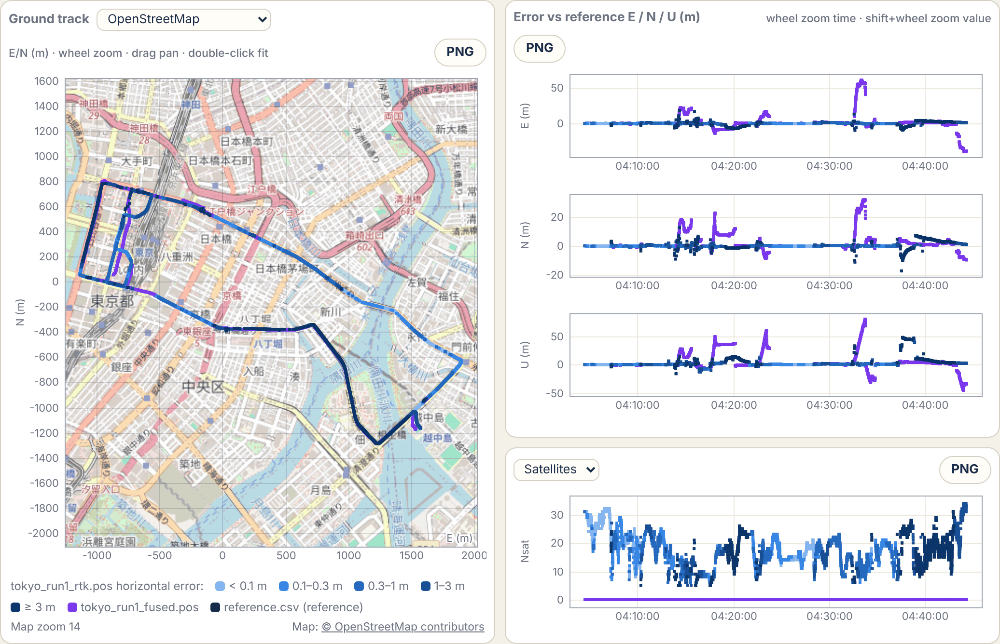

# Browser GUI (WebAssembly)

**Open it: <https://rsasaki0109.github.io/gnssplusplus-library/app/>**

An RTKLIB-style GUI that runs entirely in the browser. The libgnss++
command-line tools are compiled to WebAssembly unchanged, so a run in the
browser executes the same `main()` as the native CLI, with the same
options and output formats. Files stay in the browser (in the tab's memory,
or in the browser's own storage with *Keep files after reload*); nothing is
uploaded to a server. The only requests the page makes to other sites are
map tiles, and only after you choose a map background in Plot.

| GUI tool | RTKLIB counterpart | Runs | Typical command it shows |
| --- | --- | --- | --- |
| Post-process | RTKPOST | `gnss_spp`, `gnss_solve`, `gnss_fuse`, `gnss_fgo`, `gnss_ppp` | `gnss solve --rover rover.obs --base base.obs --nav base.nav --out rover_rtk.pos --mode kinematic` |
| Convert | RTKCONV | `gnss_convert` | `gnss convert --input base.rtcm --format rtcm --gps-week 2324 --obs-out base.obs --nav-out base.nav` |
| Plot | RTKPLOT | (in the page) | ground track, E/N/U or error vs reference, satellites / ratio / PDOP, statistics |
| Observations | RTKPLOT (observation data, skyplot) | `gnss_visibility` | `gnss visibility --obs rover.obs --nav base.nav --csv rover_vis.csv --summary-json rover_vis_summary.json` |
| RINEX info | — | `gnss_rinex_info` | `gnss rinex-info --count-records rover.obs base.nav` |

Every run prints the equivalent `gnss ...` command, so a browser session can
be repeated natively, for example on a larger dataset or in a script.



## Quick tour

1. Press **Run demo pipeline** in the Files panel. It loads a 40 s excerpt of
   the PPC Tokyo run1 drive (RTCM3 rover and base streams plus the reference
   trajectory), converts both streams to RINEX, runs kinematic RTK and opens
   the result in Plot with the errors against the reference.
2. Or add your own files with **Add files** or drag and drop: RINEX OBS/NAV,
   SP3, CLK, ANTEX, QZSS L6 logs (CLAS, MADOCA L6E / L6D), Galileo HAS
   E6-B page logs (cssrlib text; Septentrio SBF), BeiDou PPP-B2b message logs
   (cssrlib text), RTCM3 (including RTCM SSR),
   u-blox UBX, `.pos` (libgnss++ or RTKLIB) and reference CSV files are
   recognised from their content. Files are lost on reload unless
   **Keep files after reload** is ticked: then inputs and outputs are kept in
   this browser's IndexedDB (on this device, for this site only) and come
   back on the next visit; the note next to it shows how much is kept.
   Removing a file, **Clear**, or unticking the box deletes the stored
   copies. Browsers limit and may evict site storage, and private windows
   usually have none (the box is then disabled).
3. Outputs (`.pos`, `.kml`, RINEX, summary JSON) appear in Files; download
   them or open `.pos` files in Plot. Solution 2 and a reference trajectory
   can be overlaid, as in RTKPLOT. The ground track can be drawn over a map
   (see [Map backgrounds](#map-backgrounds)). With a reference loaded,
   *Colour solution 1 by* → *Horizontal error vs reference* colours its
   epochs in five classes (< 0.1, 0.1–0.3, 0.3–1, 1–3, ≥ 3 m; light to dark)
   instead of by FIX / FLOAT, on every plot, so the stretches where the
   solution goes wrong stand out on the map. **PNG** on each plot saves it
   as an image with its legend (and the map credit when a map is shown).
   For a static receiver, type its coordinate in *Reference point* (ECEF
   X Y Z, or lat lon h) instead of choosing a reference file. With any
   reference, the third plot can show the horizontal or |up| error with the
   *Converged when* thresholds (default 0.2 m / 0.4 m), and Statistics gives
   the convergence time (from the first epoch to the time after which every
   epoch stays below the threshold, as `gnss reproduce has-idd-ppp` scores
   it) and the error at 10, 30 and 60 minutes, for solution 1 and 2 side by
   side. On the OBE4 HAS IDD sample it reads H < 0.2 m after 5.8 min and
   |U| < 0.4 m after 0.0 min, as the lane's table.
4. **Observations** shows the data before you solve: a skyplot, one tracking
   row per satellite coloured by SNR (or system) with loss-of-lock (LLI)
   slip ticks, SNR against elevation, the satellite count and a per-satellite
   table. Hovering a time highlights the satellites of that epoch on the
   skyplot. The receiver position for azimuth/elevation comes from the RINEX
   header, else the first SPP fix (rover files converted from RTCM have no
   header position), or an ECEF position you enter.



Post-process exposes the everyday options (positioning mode, elevation mask,
RTK preset, ionosphere option, ratio threshold, base position, KML) and an
**Extra arguments** field for everything else in `gnss solve --help-advanced`,
`gnss spp --help` or `gnss ppp --help`. A token in that field that equals a
file name in Files (an ANTEX or BLQ file, a TOML config) is mounted as an
input automatically.

**Real-time equivalent** (SPP, RTK and PPP modes) adds `--realtime`: each
epoch is solved only with data available at that epoch, as a real-time
receiver would. That means:

- no base interpolation towards the next base epoch;
- no later SSR corrections;
- ephemerides only once broadcast;
- no SP3 / CLK products.

Use it for real-time performance and leave it off for the best
post-processed result ([Real-time and post-processing
modes](processing_modes.md)). It is saved in options files as
`realtime = true`.

**Kinematic RTK + IMU** runs `gnss fuse` with an IMU CSV (PPC format, or
rtklibexplorer with *IMU format*), the IMU-to-antenna lever arm in body FLU
and, by default, the tight-coupling preset (`--navi776-tc`). It writes the
fused trajectory, the RTK solution the fusion ran on (`*_rtk.pos`) and,
with *Write KML*, the fused trajectory as KML; open both `.pos` files in Plot
(solution 1 / solution 2) to compare. The sample `imu.csv`
covers the 40 s RTCM3 excerpt and fills in the PPC Tokyo lever arm
`0.31, 0, 0.55`. The benefit depends on the data and tuning: see
[RTK only vs RTK + GNSS/IMU on PPC](ppc_rtk_vs_gnss_imu_fusion.md) for the
full-run comparison and its caveats.

**Kinematic FGO (batch, experimental)** runs `gnss fgo`: one factor graph
over the whole span (or *Max epochs*) with code, TDCP and double-difference
carrier factors, solved with the Eigen backend (the GTSAM backend and the
IMU factors are not in the browser build). *FGO preset* picks
`real-data-float` (default), `real-data-fixed` (adds LAMBDA ambiguity
fixing, see below) or `default`; *AR ratio threshold* maps to
`--lambda-ratio-threshold`. It gives a solution at every epoch but is not
more accurate than RTK on the PPC data checked, so treat it as a comparison
tool:

| Data (vs PPC reference) | RTK (`gnss solve`) | FGO `real-data-float` |
| --- | --- | --- |
| Sample 40 s (201 epochs) | 197 FIX, horizontal RMS 0.06 m | all FLOAT, 0.14 m |
| Tokyo run1 first 400 s | 39 % FIX, 0.43 m (FIX 0.04 m) | all FLOAT, 0.83 m |
| Tokyo run1 full (11 866 epochs) | 10 755 epochs solved, 2.7 m (H95 6.7 m) | all 11 866, 3.6 m (H95 7.5 m) |

`real-data-fixed` runs with `--epoch-lambda-fixed-output
--report-batch-fix-as-float`: an epoch is FIX only when its own conditional
LAMBDA update passes. The batch fix on its own labels every epoch FIX while
the positions stay float-level (the carrier-only Eigen caveat in
[RTK only vs RTK + GNSS/IMU on PPC](ppc_rtk_vs_gnss_imu_fusion.md)); on the
Tokyo run1 400 s window it marked all 2000 epochs FIX with a median 3D
error of 0.98 m (64 % over 0.5 m). With the per-epoch output, 22 epochs are
FIX there (median 3D 0.03 m, none over 0.5 m) and 138 over the full run
(1.2 %, median 0.05 m, max 0.31 m). The per-epoch updates make long spans
much slower (full Tokyo run1: 268 s natively against 28 s for
`real-data-float`), so use *Max epochs* to try it on a window first.

Memory grows with the span: about 0.25 GB plus 0.17 MB per epoch (2.3 GB
natively for the full Tokyo run1), within the 4 GB of a browser run.
`gnss fgo` has no `--config`, so FGO settings are not saved.

### PPP corrections: Galileo HAS, BeiDou PPP-B2b, QZSS MADOCA-PPP and CLAS

In the PPP modes, *PPP corrections* picks where the corrections come from:

- *Broadcast / precise products*: the NAV, SP3 and CLK files above.
- *Galileo HAS, internet*: the HAS Internet Data Distribution recorded as an
  RTCM 3 SSR file, with the broadcast NAV of the same day:
  `gnss ppp --ssr-rtcm <file> --ssr-rtcm-profile has-idd` (IODE-matched
  orbits, ephemerides from the stream, Galileo I/NAV only; see
  [Galileo HAS support](galileo_has.md)).
- *Galileo HAS, signal in space*: the E6-B pages a receiver logged, as cssrlib
  text, u-blox RXM-SFRBX or Septentrio SBF, with a NAV that holds Galileo
  I/NAV: `gnss ppp --has-pages <log> --has-pages-format <format>`, the format
  taken from the log's content. HAS carries no phase biases, so both HAS modes
  are float PPP (no ambiguity resolution), and East Asia / the Pacific
  (90°E–180°E) is outside the service area.
- *BeiDou PPP-B2b*: the B2b messages a receiver logged from the BDS GEO
  satellites, as cssrlib text, with a RINEX 4 NAV holding the BeiDou B-CNAV1
  (CNV1) records of the same time, such as the receiver's own:
  `gnss ppp --b2b <log>`. Float PPP with GPS and BDS-3 over China and the
  Asia-Pacific; add an ANTEX file for the BDS antenna offsets (see
  [BeiDou PPP-B2b support](bds_ppp_b2b.md)).
- *QZSS MADOCA-PPP*: raw L6E logs (orbit, clock and bias; tick every channel
  and hour of the run, e.g. PRN 204 and 206) and, optionally, L6D logs
  (ionosphere over Japan and Australia), with the broadcast NAV of the same
  day: `gnss ppp --madoca-l6 ... --madoca-l6d ...`, decoded natively. L6D
  needs the per-frequency filter, so it adds `--ar-method per-freq`.
  *PPP ambiguity resolution* adds the PPP-AR settings of MADOCALIB's `pppar`
  sample, which the CI MADOCA matrix also uses: ratio 1.5 unless set, and
  `--convergence-policy local-enu` with 0.75 m / 1.25 m thresholds.
- *QZSS CLAS (experimental)*: one raw CLAS L6 log, decoded natively for the
  CLAS OSR PPP-RTK filter (`--ssr <log> --clas-osr`).

The L6 lists recognise each log's service from its frame headers (vendor
and correction service bits), so they tick the L6E and L6D files on their
own. An ANTEX file can be added to any PPP mode. The logs are the 250-byte
frames of an L6 receiver or the hourly files of the QZSS archive; see
[QZSS L6, CLAS, and MADOCA](use_cases/qzss_l6.md).

On the public samples, the Docs workflow runs both in Node and in Chromium
and compares them with native `gnss ppp`:

| Public sample | Run | Result |
| --- | --- | --- |
| MADOCALIB 0089f7dc: IGS MIZU, 2025-04-01 00–01 h, L6E 204/206, L6D 200/201, ANTEX | kinematic PPP-AR, 120 epochs | 118 solved, 91 FIX (MADOCALIB: 97); without L6D 108 FIX / 10 FLOAT, as MADOCALIB. Same status as native at every epoch, positions within 0.01 mm. 5.8 s in Chromium, 2.5 s natively |
| CLASLIB 4320e844: 2019-08-27 (`0627239Q.obs`, `2019239Q.l6`) | static, 300 epochs | 298 FLOAT / 2 FIX, horizontal RMS 1.6 m over the last 100 epochs from the station coordinate; byte-identical to native. 9.5 s as WebAssembly in Node, 6–8 s natively |
| cssrlib-data ec1dfa2c: OBE4 2023-08-17, HAS IDD (`idd2023229c.rtc`) | static, 1800 epochs (30 min) | 0.12 m horizontal from the OBE4 coordinate (also after the full hour, `gnss reproduce has-idd-ppp`); final position within 0.01 mm of native. 4 s natively |
| cssrlib-data ec1dfa2c: Kamakura 2025-02-15, E6-B pages (`046r_gale6.txt`) and the receiver's NAV | static, 1800 epochs (30 min) | 0.07 m horizontal from the Kamakura coordinate, indicative only (outside the HAS service area); final position within 0.01 mm of native. 4 s natively |
| cssrlib-data ec1dfa2c: Kamakura 2025-02-15, PPP-B2b (`046r_bdsb2b.txt`, C59) and the receiver's RINEX 4 NAV, igs20.atx, 10° mask | static, 1800 epochs (30 min) | 0.11 m horizontal from the Kamakura coordinate (0.01 m after the full hour); final position within 0.01 mm of native. 4 s natively |

cssrlib-data is MIT-licensed, but its LICENSE leaves the sample data to their
sources' terms, so CI checks them out for the test and nothing is
redistributed. MIZU's RINEX header position is 4.4 m
from its PPP-AR fixed solution
([MADOCALIB native migration](madocalib_native_migration.md)), so it is not
a truth for scoring. CLAS is marked experimental: the CLI's `gnss clas-ppp`
expands L6 with Python, which the browser cannot run, and gives 1.4 m on
the same window. Its PPC Tokyo run1 decision is *degraded*: FIX in 10.7 %
of the epochs (see [sub-metre fleet tracking](use_cases/clas_submeter.md)).

**Save options** writes the RTK, RTK + IMU or PPP settings as the flat TOML
that `gnss solve --config`, `gnss fuse --config` and `gnss ppp --config`
read (input and output files, including L6 logs, are left out, as in RTKPOST's options file); **Load options**, or *load* on a
`.toml` in Files, reads one back, including the repository examples in
`configs/examples/`. Options the form has no field for become extra
arguments. For example, a saved static RTK setup runs natively as:

```bash
gnss solve --config rover_rtk_options.toml --rover rover.obs --base base.obs --nav base.nav --out rtk.pos
```

`gnss spp` and `gnss fgo` have no `--config`, so SPP and FGO settings are not
saved.

## Map backgrounds

The selector next to *Ground track* in Plot puts web map tiles under the
trajectory: OpenStreetMap, or, for Japan, the GSI standard map or GSI
aerial photos (地理院タイル). Wheel zoom, drag and double-click fit work as
without a map, and the map follows.



The screenshot shows the full PPC Tokyo run1 (`gnss solve` RTK as solution 1,
coloured by error; `gnss fuse` as solution 2; map © OpenStreetMap
contributors).

- The track stays in the same E/N metres around the plot origin as the time
  series and statistics; each tile is placed by converting its corner
  latitude / longitude to that frame, so switching the map on or off does
  not move the track. The map is drawn for views up to 300 km across.
- Tiles are fetched from the chosen server directly by the browser (no
  solution data is sent, but the server sees which area you view). The
  choice is remembered in this browser; *No map*, the default, makes no
  requests.
- The tile servers' attribution is shown under the plot. Use the public
  servers for interactive viewing only; their usage policies
  ([OpenStreetMap](https://operations.osmfoundation.org/policies/tiles/),
  [GSI](https://maps.gsi.go.jp/development/ichiran.html)) apply.
- Offline, or when the tiles are blocked, the plot says so and draws the
  track without a map.

## What runs where

```text
page (index.html, js/app.js)          one module worker per run (js/worker.js)
  Files (in-memory Blobs)   ───────▶   fresh Emscripten instance of <tool>.wasm
  forms -> argv (js/commands.js)       inputs mounted read-only at /in (WORKERFS)
  Plot (js/plot.js, canvas)  ◀───────   main(argc, argv) -> files in /out
```

- **Abort** terminates the worker; the page stays responsive during a run.
- Each run starts a new module instance, so no solver state carries over.
- Memory is limited to 4 GB per run (wasm32). Input files are read in place
  (not copied into the page's memory). Full-size data works: PPC Tokyo run1
  (90 MB rover + 36 MB base RINEX, 40 min at 5 Hz) solves in about 75 s in
  Chromium against 64 s for the native `gnss solve`, with the same FIX/FLOAT
  epochs and positions within 0.1 mm of the native run.
- Live inputs (NTRIP, serial ports, TCP) are not available in a browser; use
  `gnss live` natively for real-time work.
- Browser support: current Chrome / Edge, Firefox and Safari (module workers
  and WebAssembly exception handling: Chrome/Edge 95+, Firefox 114+,
  Safari 15.2+).

## Build and run locally

The GitHub Pages workflow (`.github/workflows/docs.yml`) builds the tools with
the official Emscripten image, runs a Node smoke test of the demo pipeline and
publishes the app under `/app/`. To do the same locally with an
[Emscripten SDK](https://emscripten.org/docs/getting_started/downloads.html):

```bash
bash wasm/build.sh                                # emcmake cmake + build
node wasm/test/smoke.mjs build-wasm/wasm/dist     # same pipeline as the demo
python3 wasm/assemble_site.py --dist build-wasm/wasm/dist --out build-wasm/site
python3 -m http.server -d build-wasm/site 8000    # open http://localhost:8000/
```

`wasm/README.md` lists the Emscripten settings and how a tool is added.
